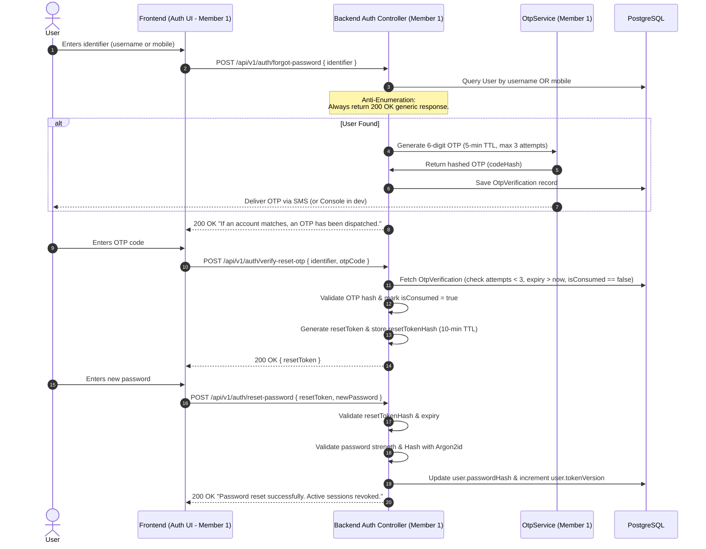

# INARO — Master System Architecture

This document specifies the technical architecture, component interactions, runtime lifecycles, and reliability patterns for the INARO mental well-being companion application.

---

## 1. High-Level Architecture Overview

INARO is architected as a modular, contract-first web application consisting of three distinct execution layers:

1. **Frontend Client (SPA)**: Built with React, Vite, and TypeScript. Houses the Owner's dynamic AI Avatar rendering engine, responsive UI theme system, and individual module views.
2. **Core Application Backend**: Built with Node.js and TypeScript. Coordinates identity, data access, Gemini conversation streams, 30-day retention workers, and the notification engine.
3. **ML & Audio Microservice**: Built with Python 3.10+ and FastAPI. Dedicated exclusively to audio feature extraction, speech processing, and running the custom-trained Vocal Tone Emotion Model.
4. **Data & Storage Layer**: PostgreSQL relational database managed via Prisma ORM for transaction safety and schema integrity.

```
┌────────────────────────────────────────────────────────────────────────┐
│                        INARO FRONTEND (SPA)                            │
│  - React 18+ (Vite, TypeScript, Vanilla CSS Design Tokens)             │
│  - Owner Scope: Avatar Component (Canvas/SVG), Viseme Lip-Sync, Themes │
│  - Client Audio Recorder & Web Speech / MediaStream API                │
└───────────────────▲────────────────────────────────▲───────────────────┘
                    │ REST / SSE                     │ Multipart Audio / REST
                    ▼                                ▼
┌──────────────────────────────────────┐  ┌──────────────────────────────┐
│        CORE BACKEND SERVICE          │  │     ML & AUDIO SERVICE       │
│  - Node.js (TypeScript, Fastify/Exp) │  │  - Python 3.10+ (FastAPI)    │
│  - Prisma ORM                        │  │  - PyTorch / Librosa / NumPy │
│  - Auth & OTP (Member 1)             │  │  - Vocal Emotion Inference   │
│  - Gemini API Client (Members 2 & 3) │  │  - Feature Extraction (MFCC) │
│  - Retention Worker (Members 2 & 3)  │  │  - Training & Eval Scripts   │
│  - Dump & Notif Engine (Member 4)    │  └──────────────▲───────────────┘
└───────────────────▲──────────────────┘                 │
                    │                                    │ Reads Weights
                    ▼                                    ▼
┌──────────────────────────────────────┐  ┌──────────────────────────────┐
│         POSTGRESQL DATABASE          │  │     LOCAL MODEL REGISTRY     │
│  - Users, Contacts, Helplines        │  │  - `models/checkpoints/`     │
│  - Characters, Chats, Summaries      │  │  - `dataset/processed/`      │
│  - Dump Entries, Mood/Sleep Logs     │  │  - Model metadata & metrics  │
└──────────────────────────────────────┘  └──────────────────────────────┘
```

---

## 2. Subsystem Descriptions & Responsibilities

### 2.1 Owner Module: AI Avatar & Mood-Responsive UI
- **Avatar Rendering Engine**: Implemented using HTML5 Canvas or scalable SVG elements. Maintains smooth, interpolated facial state transitions between emotional states (`happy`, `sad`, `calm`, `concerned`, `surprised`, `neutral`).
- **Autonomous Blinking Loop**: Random interval timer (2-6 seconds) triggering natural eyelid closure and opening independently of conversation state.
- **Speech-Synchronized Lip-Sync**: Receives audio playback duration and viseme/amplitude markers to drive mouth opening and closing during AI voice response.
- **Mood-Responsive Theming**: Evaluates current interaction mood and shifts CSS custom properties (`--mood-primary`, `--mood-bg-gradient`, `--mood-primary-glow`) with 600ms ease transitions.
- **Safety Fallback**: If the ML service is unreachable or emotion confidence is low (< 0.60), the avatar gracefully reverts to the default `"calm"` or `"neutral"` expression.

### 2.2 Interactive Mode, AI Dialogue & Voice Pipeline (Members 2 & 3 — Joint Scope)
- **Multi-Character System**: Manages character profiles (name, personality description, system prompt, avatar visual style).
- **Gemini Integration**: Uses Google's `@google/genai` SDK on the backend. Packages character system instructions, past conversation summaries, and the user's latest message into structured prompts.
  - *Model Selection Note*: The default configured model is `gemini-1.5-flash`. Model availability and regional tier must be verified in Google AI Studio at deployment time; the model identifier is decoupled via `GEMINI_MODEL` in `.env` and can be adjusted without rewriting code.
- **Tamil Language Handling**: Directs Gemini to respond in natural Tamil script (`தமிழ்`) when the user communicates in Tamil, maintaining conversational nuances.
- **30-Day Conversation Retention Worker**: A nightly background job computes rolling semantic summaries of active conversations older than 30 days, stores the condensed summary in `ConversationSummary`, and purges raw message history to honor user privacy.
- **Vocal Tone Emotion Recognition**: A custom deep learning model trained on audio datasets that classifies acoustic properties (pitch, prosody, spectral flux) into an emotion vector.
- **Speech-to-Text (STT) & Text-to-Speech (TTS)**: Bilingual audio processing with native Tamil (`ta-IN`) and English support.

### 2.3 Authentication, Identity & User Management (Member 1)
- **Registration & Login**: Full name, username, age check, personal mobile number, password, and optional trusted contact.
- **Pluggable OTP Verification**: Abstracted `OtpService` interface with `ConsoleDevOtpProvider` (logs OTP to terminal for local dev) and SMS integration for production.
- **Complete Forgot-Password Flow**: Identifier submission (username or mobile), generic anti-enumeration response, OTP verification with SHA-256 code hash, single-use `resetTokenHash`, 10-minute expiry, Argon2id password reset, and session revocation via `tokenVersion` increment.
- **Trusted Contact & Fallback**: Captures trusted person details with user consent. If omitted, routes the user to the verified counselling helpline pathway.

### 2.4 Dump Mode, Trackers, Notifications & Helplines (Member 4)
- **Dump Mode**: Private, unguided journaling space supporting both typed text and voice recordings converted to text. Users can create, view, rename, and delete entries. **Strictly unanalyzed**: No AI advice, critique, or emotional scoring is generated for Dump Mode entries.
- **Daily Mood & Sleep Trackers**: Non-intrusive daily dials to log self-reported mood (1-5) and sleep duration (hours).
  - *Missing Record Rule*: If a user does not log, no row is created in `DailyMoodLog`. Missing days are strictly ignored by the rolling 7-day evaluator.
- **Notification Subsystem**: Separation of notification delivery infrastructure from policy rules. Dispatches gentle reminders when Dump Mode has been inactive for >24 hours, respecting user opt-in preferences.
- **Shared Helpline Registry**: Database-driven directory of institutional crisis and support hotlines. Exposes click-to-call buttons (`tel:`) that open the user's native phone dialer without unauthorized auto-dialing. New entries default to `isVerified: false`.

---

## 3. Seven-Day Rolling Safety & Immediate Triage Architecture

To balance proactive well-being support with strict ethical boundaries, INARO implements a two-tier safety architecture:

```
                                USER INTERACTION
                                        │
                    ┌───────────────────┴───────────────────┐
                    ▼                                       ▼
       [Tier 1: Immediate Triage]             [Tier 2: 7-Day Rolling Analysis]
     - Scans text/voice transcripts         - Evaluates daily mood/sleep logs
     - Immediate regex & keyword triggers   - Evaluates recorded low-mood entries
                    │                                       │
            Is Acute Distress?                     Count Flagged Days in 7d
              /           \                                 │
           YES             NO                ┌──────────────┼──────────────┐
            │               │                ▼              ▼              ▼
     Immediate Crisis   Normal Flow     < 4 Days       = 4 Days       > 4 Days
     Modal Overlay                      (Standard)    (Supportive)   (Elevated)
     (Hotlines + Dial)
```

### 3.1 Tier 1: Immediate Safety Monitoring (Decoupled & Real-Time)
- **Trigger**: Any message containing explicit expressions of self-harm, severe crisis, or suicidal intent.
- **Action**: Immediate modal overlay displaying verified crisis hotlines with click-to-call buttons. If a trusted contact is registered with consent, offers a one-tap prompt to reach out.
- **Decoupled**: Does **not** wait for rolling daily logs.

### 3.2 Tier 2: Seven-Day Rolling Safety Rules
Evaluates the user's recorded states over the preceding 7 calendar days:
1. **Fewer than 4 Flagged Days (0–3 days)**:
   - *Status*: Standard well-being range (`STANDARD_SUPPORT`).
   - *Behavior*: Normal character interactions; no elevated safety prompts; empathetic companionship.
2. **Exactly 4 Flagged Days**:
   - *Status*: Moderate distress pattern (`MODERATE_SUPPORT`).
   - *Behavior*: Delivers a gentle, supportive reflection prompt (e.g., *"It seems like things have felt heavy on several days this week. Would you like to take a breath together, jot your thoughts in Dump Mode, or reach out to someone you trust?"*). No clinical claims made.
3. **More than 4 Flagged Days (5–7 days)**:
   - *Status*: Persistent distress pattern (`ELEVATED_SUPPORT`).
   - *Behavior*: Displays an elevated well-being check-in card. Offers direct access to verified counselling helpline resources and prompts the user to consider connecting with their registered trusted contact.
4. **Missing Data Handling**:
   - Days where the user did not log mood or sleep have **no row created** (`null`).
   - **Missing days are strictly neutral** and are **never** counted as flagged days or treated as evidence of depression.
5. **Consent & Privacy Limits**:
   - The system **never** shares raw conversation transcripts or Dump Mode entries with trusted contacts.
   - Notifications to trusted contacts only occur with explicit user consent and voluntary action.
6. **Non-Clinical Guarantee**:
   - All prompts and UI text are supportive and reflective. Inferred emotions and mood patterns are **never presented as medical or clinical psychiatric diagnoses**.

---

## 4. Trusted Contact & Location-Based Helpline Fallback Behavior

1. **Trusted Contact Role & Consent**:
   - Capturing a trusted contact's phone number during registration is **strictly optional**.
   - If provided, the user must explicitly toggle a consent checkbox explaining that the contact will only be suggested during critical support check-ins.
2. **Helpline Fallback Pathway**:
   - When a user elects not to provide a trusted contact, the application automatically presents the **Verified Counselling Helpline Pathway** as the default emergency support channel.
   - This ensures every user has an accessible, verified safety net regardless of their personal social network.
3. **Location-Based Resource Matching**:
   - The shared helpline directory supports regional filtering (e.g., National Tele-MANAS, KIRAN, state-specific counselling lines).
   - The application selects relevant hotlines based on user-selected language (`Tamil`, `English`, `Hindi`) and geographic context where available.
4. **Verified-Resource Data Ownership & Disclaimer**:
   - The helpline directory is maintained as a shared backend database entity owned by Member 4.
   - **Verification Default**: New helpline resources are `isVerified: false` by default. Only resources with documented administrative evidence may be marked `isVerified: true`.
   - **Disclaimer**: All helpline numbers referenced in documentation or seeds are illustrative public examples requiring formal administrative verification prior to production deployment.

---

## 5. End-to-End Forgot-Password Flow Architecture



---

## 6. Failure Handling, Resilience & Circuit Breakers

1. **Gemini API Outages or Rate Limits (429/503)**:
   - Backend implements exponential backoff (retries at 1s, 2s, 4s).
   - If retries fail, returns a polite fallback message: *"I'm having a brief connection issue, but I'm here. You can take a moment in Dump Mode or review our support helplines."*
2. **ML Service Downtime**:
   - The frontend avatar checks ML service health. If the ML endpoint times out (>500ms) or errors, the avatar transitions smoothly to the `"calm"` expression and continues conversational dialogue without blocking the user.
3. **Network Disconnection**:
   - Dump Mode entries are cached in client `localStorage` until the backend connection is restored, preventing user data loss.
