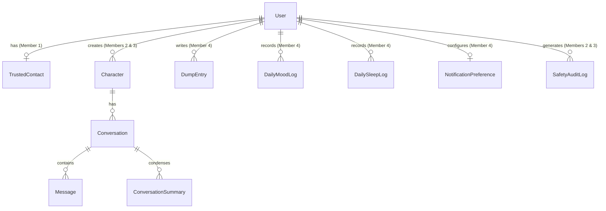

# INARO — Database Schema & Data Dictionary

This document details the PostgreSQL relational database schema, entity relationships, indexes, 30-day retention policies, secure token lifecycles, and data privacy safeguards for INARO.

---

## 1. Entity-Relationship Overview



---

## 2. Table Definitions & Data Dictionary

### 2.1 Table: `User` (Owner: Member 1)
Stores user credentials, profile metadata, and verification state.
- `id` (UUID, PK): Unique user identifier.
- `username` (VARCHAR(30), Unique, Indexed): User login handle.
- `fullName` (VARCHAR(100)): Full name for personalizing greeting.
- `age` (INTEGER): Age check.
- `mobileNumber` (VARCHAR(15), Unique, Indexed): Primary personal contact.
- `isMobileVerified` (BOOLEAN): Mobile ownership verified via OTP.
- `passwordHash` (TEXT): Argon2id hashed password string.
- `tokenVersion` (INTEGER, Default: 0): Incremented upon password reset to instantly invalidate active JWT sessions across all devices.
- `createdAt` / `updatedAt` (TIMESTAMP).

### 2.2 Table: `OtpVerification` (Owner: Member 1)
Transient verification codes and reset authorization tokens.
- `id` (UUID, PK): Unique verification record ID.
- `identifier` (VARCHAR(50), Indexed): Destination mobile number or username.
- `codeHash` (TEXT): Cryptographic hash (SHA-256) of 6-digit OTP code; plaintext is never stored.
- `purpose` (VARCHAR(20)): `"REGISTER"` or `"PASSWORD_RESET"`.
- `resetTokenHash` (TEXT, Nullable, Unique): Cryptographic hash (SHA-256) of single-use reset authorization token.
- `expiresAt` (TIMESTAMP): Expiry timestamp (strict 5-minute TTL for OTP).
- `resetTokenExpiresAt` (TIMESTAMP, Nullable): Expiry timestamp (strict 10-minute TTL for password reset completion).
- `attempts` (INTEGER, Default: 0): Failed verification attempt counter. Reaching 3 failed attempts locks the code.
- `isConsumed` (BOOLEAN, Default: false): Single-use enforcement flag. Marked `true` upon verification.
- `createdAt` (TIMESTAMP, Default: now()).

### 2.3 Table: `TrustedContact` (Owner: Member 1)
Emergency support contact provided during registration.
- `id` (UUID, PK).
- `userId` (UUID, FK -> User.id, Unique): One-to-one with user.
- `contactName` (VARCHAR(100)): Name of the trusted individual.
- `mobileNumber` (VARCHAR(15)): Trusted person's phone number.
- `consentGiven` (BOOLEAN): User confirmed consent for emergency notifications.
- **Fallback Rule**: When omitted or consent is withheld, user is routed to the verified counselling helpline pathway.

### 2.4 Table: `Character` (Owner: Members 2 & 3 — Joint Scope)
Custom AI personalities configured by the user.
- `id` (UUID, PK).
- `userId` (UUID, FK -> User.id, Indexed): Character owner.
- `name` (VARCHAR(50)): e.g. "Maya", "Kavitha".
- `avatarStyle` (VARCHAR(30)): Visual preset identifier.
- `systemPrompt` (TEXT): Base instruction passed to Gemini API.
- `toneDescription` (VARCHAR(100)): e.g. "Calm, empathetic, supportive".
- `isArchived` (BOOLEAN): Soft delete flag.

### 2.5 Table: `Message` & `ConversationSummary` (Owner: Members 2 & 3 — Joint Scope)
Manages conversational history and 30-day retention rolling memory.
- `Message`:
  - `id` (UUID, PK).
  - `conversationId` (UUID, FK -> Conversation.id, Indexed).
  - `sender` (VARCHAR(10)): `"USER"` or `"AI"`.
  - `textContent` (TEXT): The message payload.
  - `audioUrl` (TEXT, Nullable): Ephemeral voice note reference.
  - `createdAt` (TIMESTAMP, Indexed): Evaluated by 30-day retention purge worker.
- `ConversationSummary`:
  - `id` (UUID, PK).
  - `conversationId` (UUID, FK -> Conversation.id, Indexed).
  - `summaryText` (TEXT): Condensed rolling memory context.
  - `periodStart` / `periodEnd` (TIMESTAMP): Date coverage of the summary.

### 2.6 Table: `DumpEntry` (Owner: Member 4)
Private unstructured thoughts space.
- `id` (UUID, PK).
- `userId` (UUID, FK -> User.id, Indexed).
- `title` (VARCHAR(150)): Entry title (default: "Untitled Entry").
- `content` (TEXT): Private body text.
- `moodTag` (VARCHAR(30), Nullable): Optional tag selected by user.
- `createdAt` / `updatedAt` (TIMESTAMP).
- **Privacy Rule**: Dump entries are isolated from Gemini API context and training sets.

### 2.7 Table: `DailyMoodLog` & `DailySleepLog` (Owner: Member 4)
- `DailyMoodLog`: Unique constraint on `[userId, date]`. Records `moodRating` (1-5 scale).
- `DailySleepLog`: Unique constraint on `[userId, date]`. Records `durationHours` (Float).
- **Missing Value Semantics**:
  - If a user misses logging for a date, **no row exists in the database**.
  - **The rolling seven-day evaluator must ignore missing days rather than treating them as flagged or distress indicators.**
  - Missing days are not backfilled, not assigned default negative scores, and not treated as evidence of depression.

### 2.8 Table: `HelplineResource` (Owner: Member 4 / Shared)
Directory of institutional mental health support services.
- `id` (VARCHAR(20), PK).
- `category` (VARCHAR(50)): e.g. "GOVERNMENT", "CRISIS_COUNSELLING", "STUDENT_SUPPORT".
- `serviceName` (VARCHAR(100)): Official organization title.
- `phoneNumber` (VARCHAR(20)): Dialable phone number.
- `description` (TEXT): Scope of services provided.
- `operatingHours` (VARCHAR(50)): e.g. "24/7", "9 AM - 6 PM".
- `languageSupported` (VARCHAR(100)): e.g. "Tamil, English, Hindi".
- `region` (VARCHAR(50)): e.g. "National", "Tamil Nadu".
- `isVerified` (BOOLEAN, Default: `false`): **New resources are unverified by default.** Requires an explicit administrative verification process with documented evidence before marking `true`. Phone numbers must not be claimed as verified without documented confirmation.

### 2.9 Table: `SafetyAuditLog` (Owner: Members 2 & 3 — Joint Scope)
- `id` (UUID, PK).
- `userId` (UUID, FK -> User.id, Indexed).
- `severityLevel` (VARCHAR(10)): Strictly uppercase `"GREEN"` | `"AMBER"` | `"RED"`.
- `evaluationTier` (VARCHAR(30)): `"IMMEDIATE_ACUTE"` | `"SEVEN_DAY_MODERATE"` | `"SEVEN_DAY_ELEVATED"`.
- `actionTaken` (VARCHAR(50)): `"DISPLAYED_HELPLINE_MODAL"` | `"OFFERED_TRUSTED_CONTACT"`.
- `timestamp` (TIMESTAMP, Indexed).

---

## 3. Seven-Day Rolling Safety & 30-Day Retention Rules

### 3.1 Seven-Day Rolling Safety Query Logic
```sql
-- Query recorded logs over the preceding 7 days
SELECT date, moodRating 
FROM "DailyMoodLog"
WHERE "userId" = :userId 
  AND date >= CURRENT_DATE - INTERVAL '6 days'
ORDER BY date DESC;
```
- Exactly 4 low-mood days ($\le 2/5$): Flags tier as `MODERATE_SUPPORT`.
- More than 4 low-mood days: Flags tier as `ELEVATED_SUPPORT`.
- Fewer than 4 low-mood days: Flags tier as `STANDARD_SUPPORT`.
- **Missing Days**: Missing days return no row. Missing days are **completely ignored** and are never counted toward the flagged days count.

### 3.2 30-Day Retention & Purge Protocol
1. **Raw Message Retention**:
   - `Message` rows older than 30 days are processed nightly by a background cron job.
   - The worker generates a high-level semantic summary using Gemini (`generateConversationSummary()`) and writes it to `ConversationSummary`.
   - The individual raw `Message` records and any temporary audio storage references are permanently deleted via database transaction.
2. **User-Initiated Purge**:
   - A user can trigger "Clear Chat History" on any character, immediately executing a cascade delete on all messages and summaries for that conversation.
