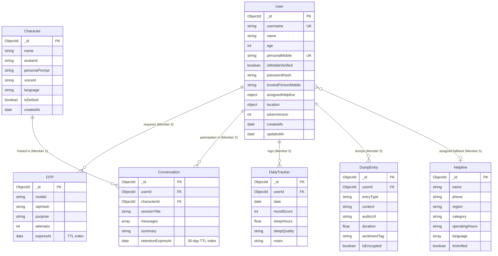

# INARO — Database Schema & Mongoose Data Models

This document details the complete MongoDB database architecture using **Mongoose ODM**. It covers entity definitions, validation rules, indexing strategies, TTL cleanup policies, and data privacy safeguards across all INARO modules.

---

## 1. Entity-Relationship Overview



---

## 2. Master Mongoose Schema Definitions

### 2.1 User Schema (Owner: Member 4)
File: `server/src/models/User.js`

```javascript
import mongoose from 'mongoose';

const UserSchema = new mongoose.Schema(
  {
    username: {
      type: String,
      required: [true, 'Username is required'],
      unique: true,
      trim: true,
      lowercase: true,
      minlength: [3, 'Username must be at least 3 characters'],
      maxlength: [30, 'Username cannot exceed 30 characters'],
      index: true,
    },
    name: {
      type: String,
      required: [true, 'Full name is required'],
      trim: true,
      maxlength: [100, 'Name cannot exceed 100 characters'],
    },
    age: {
      type: Number,
      required: [true, 'Age is required'],
      min: [13, 'User must be at least 13 years old'],
      max: [120, 'Invalid age provided'],
    },
    personalMobile: {
      type: String,
      required: [true, 'Personal mobile number is required'],
      unique: true,
      trim: true,
      match: [/^[0-9]{10}$/, 'Mobile number must be a valid 10-digit number'],
      index: true,
    },
    isMobileVerified: {
      type: Boolean,
      default: false,
    },
    passwordHash: {
      type: String,
      required: [true, 'Password hash is required'],
    },
    trustedPersonMobile: {
      type: String,
      trim: true,
      match: [/^[0-9]{10}$/, 'Trusted person mobile must be a valid 10-digit number'],
      default: null,
    },
    assignedHelpline: {
      name: { type: String, default: 'Tele-MANAS' },
      phone: { type: String, default: '14416' },
      region: { type: String, default: 'India / All States' },
    },
    location: {
      state: { type: String, trim: true, default: '' },
      country: { type: String, trim: true, default: 'India' },
    },
    tokenVersion: {
      type: Number,
      default: 0,
      description: 'Incremented on password reset to invalidate active JWTs',
    },
  },
  {
    timestamps: true,
  }
);

export default mongoose.model('User', UserSchema);
```

---

### 2.2 OTP Schema (Owner: Member 4)
File: `server/src/models/Otp.js`

```javascript
import mongoose from 'mongoose';

const OtpSchema = new mongoose.Schema(
  {
    mobile: {
      type: String,
      required: true,
      trim: true,
      index: true,
    },
    otpHash: {
      type: String,
      required: true,
    },
    purpose: {
      type: String,
      enum: ['REGISTRATION', 'PASSWORD_RESET'],
      required: true,
    },
    attempts: {
      type: Number,
      default: 0,
      max: 3,
    },
    expiresAt: {
      type: Date,
      required: true,
      default: () => new Date(Date.now() + 5 * 60 * 1000), // 5 minutes TTL
      index: { expires: 0 }, // Native MongoDB TTL index auto-deletes expired docs
    },
  },
  {
    timestamps: true,
  }
);

export default mongoose.model('Otp', OtpSchema);
```

---

### 2.3 Character Schema (Owner: Member 2)
File: `server/src/models/Character.js`

```javascript
import mongoose from 'mongoose';

const CharacterSchema = new mongoose.Schema(
  {
    name: {
      type: String,
      required: true,
      trim: true,
    },
    avatarId: {
      type: String,
      required: true,
      default: 'inaro_default_avatar',
    },
    personaPrompt: {
      type: String,
      required: true,
      description: 'System prompt configuring empathy style, tone, and active listening rules',
    },
    voiceId: {
      type: String,
      default: 'en-US-JennyNeural',
    },
    language: {
      type: String,
      enum: ['en', 'ta', 'bilingual'],
      default: 'bilingual',
    },
    isDefault: {
      type: Boolean,
      default: false,
    },
    createdBy: {
      type: mongoose.Schema.Types.ObjectId,
      ref: 'User',
      default: null,
    },
  },
  {
    timestamps: true,
  }
);

export default mongoose.model('Character', CharacterSchema);
```

---

### 2.4 Conversation Schema (Owner: Member 2)
File: `server/src/models/Conversation.js`

```javascript
import mongoose from 'mongoose';

const MessageSubSchema = new mongoose.Schema(
  {
    sender: {
      type: String,
      enum: ['user', 'assistant'],
      required: true,
    },
    text: {
      type: String,
      required: true,
    },
    audioUrl: {
      type: String,
      default: null,
    },
    emotionTag: {
      type: String,
      enum: ['calm', 'happy', 'sad', 'anxious', 'angry', 'neutral'],
      default: 'calm',
    },
    timestamp: {
      type: Date,
      default: Date.now,
    },
  },
  { _id: true }
);

const ConversationSchema = new mongoose.Schema(
  {
    userId: {
      type: mongoose.Schema.Types.ObjectId,
      ref: 'User',
      required: true,
      index: true,
    },
    characterId: {
      type: mongoose.Schema.Types.ObjectId,
      ref: 'Character',
      required: true,
    },
    sessionTitle: {
      type: String,
      default: 'Daily Check-in',
    },
    messages: [MessageSubSchema],
    summary: {
      type: String,
      default: '',
    },
    retentionExpiresAt: {
      type: Date,
      default: () => new Date(Date.now() + 30 * 24 * 60 * 60 * 1000), // 30-Day TTL
      index: { expires: 0 }, // Automatic 30-day retention enforcement
    },
  },
  {
    timestamps: true,
  }
);

export default mongoose.model('Conversation', ConversationSchema);
```

---

### 2.5 DailyTracker Schema (Owner: Member 5)
File: `server/src/models/DailyTracker.js`

```javascript
import mongoose from 'mongoose';

const DailyTrackerSchema = new mongoose.Schema(
  {
    userId: {
      type: mongoose.Schema.Types.ObjectId,
      ref: 'User',
      required: true,
      index: true,
    },
    date: {
      type: Date,
      required: true,
      default: () => new Date().setHours(0, 0, 0, 0),
    },
    moodScore: {
      type: Number,
      required: true,
      min: 1,
      max: 10,
    },
    sleepHours: {
      type: Number,
      required: true,
      min: 0,
      max: 24,
    },
    sleepQuality: {
      type: String,
      enum: ['poor', 'fair', 'good', 'excellent'],
      default: 'good',
    },
    notes: {
      type: String,
      maxlength: 500,
      default: '',
    },
  },
  {
    timestamps: true,
  }
);

DailyTrackerSchema.index({ userId: 1, date: 1 }, { unique: true });

export default mongoose.model('DailyTracker', DailyTrackerSchema);
```

---

### 2.6 DumpEntry Schema (Owner: Member 5)
File: `server/src/models/DumpEntry.js`

```javascript
import mongoose from 'mongoose';

const DumpEntrySchema = new mongoose.Schema(
  {
    userId: {
      type: mongoose.Schema.Types.ObjectId,
      ref: 'User',
      required: true,
      index: true,
    },
    entryType: {
      type: String,
      enum: ['text', 'voice'],
      required: true,
    },
    content: {
      type: String,
      default: '',
      description: 'Raw cathartic text entry (encrypted at rest)',
    },
    audioUrl: {
      type: String,
      default: null,
      description: 'Path or signed S3/GridFS URL for recorded voice notes',
    },
    duration: {
      type: Number,
      default: 0,
      description: 'Voice note duration in seconds',
    },
    sentimentTag: {
      type: String,
      default: 'unspecified',
    },
    isEncrypted: {
      type: Boolean,
      default: true,
    },
  },
  {
    timestamps: true,
  }
);

export default mongoose.model('DumpEntry', DumpEntrySchema);
```

---

### 2.7 Helpline Schema (Owner: Member 5)
File: `server/src/models/Helpline.js`

```javascript
import mongoose from 'mongoose';

const HelplineSchema = new mongoose.Schema(
  {
    name: {
      type: String,
      required: true,
      trim: true,
    },
    phone: {
      type: String,
      required: true,
      trim: true,
    },
    region: {
      type: String,
      required: true,
      index: true,
      trim: true,
    },
    category: {
      type: String,
      default: 'Crisis Support',
    },
    operatingHours: {
      type: String,
      default: '24/7',
    },
    language: {
      type: [String],
      default: ['English', 'Tamil', 'Hindi'],
    },
    isVerified: {
      type: Boolean,
      default: true,
    },
  },
  {
    timestamps: true,
  }
);

export default mongoose.model('Helpline', HelplineSchema);
```

---

## 3. Indexing & Retention Strategy

1. **User Identity Speed**: Compound and unique indexes on `username` and `personalMobile` ensure $O(1)$ lookups during authentication and registration.
2. **5-Minute OTP Ephemerality**: `expiresAt` is configured with MongoDB's native `{ expires: 0 }` TTL index, automatically dropping expired records with zero background cron overhead.
3. **30-Day Chat Retention Compliance**: `Conversation.retentionExpiresAt` enforces strict 30-day user privacy retention by purging dialogues after 30 days unless a summary is archived.
4. **Daily Mood Trackers Uniqueness**: Compound index on `{ userId: 1, date: 1 }` prevents duplicate tracker records per calendar day.
